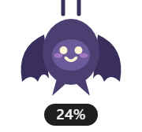
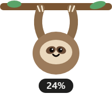
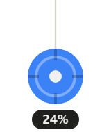
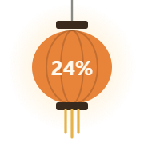
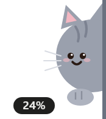
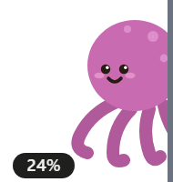
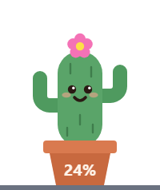
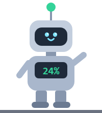
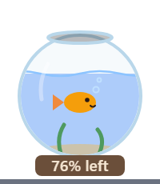
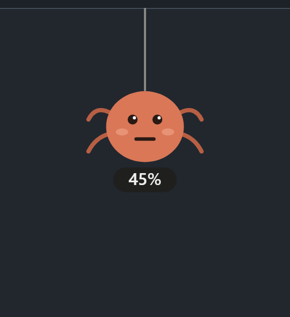

<div align="center">


# Claude Usage Pebble

**Your Claude plan usage, always one glance away.**

A tiny always-on-top desktop widget that shows your current session, this week, and any per-model weekly limits.<br>
16 layouts: compact widgets, plus little characters that hang from the top, peek in from the side or sit on the bottom of your screen.

<p>
  <a href="#download"></a>
  <a href="#download"></a>
  <a href="#download"></a>
  <a href="https://www.electronjs.org"></a>
  <a href="https://nodejs.org"></a>
  <a href="LICENSE"></a>
</p>
<p>
  <a href="https://github.com/mu-ki/claude-usage-pebble/releases"></a>
  <a href="https://github.com/mu-ki/claude-usage-pebble/stargazers"></a>
  <a href="https://github.com/mu-ki/claude-usage-pebble/commits/main"></a>
  
  <a href="#contributing"></a>
</p>

<p>
  <a href="https://github.com/mu-ki/claude-usage-pebble/releases/latest/download/claude-usage-pebble-win-x64-setup.exe"></a>
  <a href="https://github.com/mu-ki/claude-usage-pebble/releases/latest/download/claude-usage-pebble-mac-universal.dmg"></a>
  <a href="https://github.com/mu-ki/claude-usage-pebble/releases/latest/download/claude-usage-pebble-linux-x86_64.AppImage"></a>
</p>
<p>
  <a href="https://mu-ki.github.io/claude-usage-pebble/docs/gallery.html"></a>
</p>

<h3>
  <a href="#download">Download</a> ·
  <a href="#install-and-run">Quick start</a> ·
  <a href="#layouts">Layouts</a> ·
  <a href="#how-it-works">How it works</a> ·
  <a href="#build-an-app-file">Build</a> ·
  <a href="#adding-a-layout">Add a layout</a>
</h3>

```bash
git clone https://github.com/mu-ki/claude-usage-pebble.git && cd claude-usage-pebble && npm install && npm start
```

<sub>Unofficial community project. Not affiliated with or endorsed by Anthropic. "Claude" is a trademark of Anthropic.</sub>

</div>

---

## Why you'll like it

| | |
|---|---|
| 🪶 **Tiny and out of the way** | Sits on top of every window, takes a few pixels, drag it anywhere. |
| 📊 **Every limit at once** | Current session, this week, and per-model weekly limits (for example Fable). |
| 🎨 **16 layouts** | Five compact widgets and 11 characters that hang from the top, peek in from the side or sit on the bottom of your screen. Switch with a right-click. |
| 🚦 **Warns you early** | At 80%, 90% and 100% a speech bubble pops up and the widget nudges you. Characters look worried, and bars turn amber at 75% and red at 90%. |
| 🔒 **Private by design** | Talks only to claude.ai. No server, no analytics, no telemetry. |
| 💻 **Cross-platform** | Windows, macOS and Linux, from one small Electron app. |

## Download

Each link downloads the newest version straight away:

| OS | Download | Notes |
|---|---|---|
| Windows 10/11 | [**claude-usage-pebble-win-x64-setup.exe**](https://github.com/mu-ki/claude-usage-pebble/releases/latest/download/claude-usage-pebble-win-x64-setup.exe) | **Installer (recommended).** Installs for your user only (no admin needed), adds Start-menu and desktop shortcuts, starts instantly, and uninstalls from **Settings → Apps**. |
| Windows 10/11, portable | [claude-usage-pebble-win-x64.exe](https://github.com/mu-ki/claude-usage-pebble/releases/latest/download/claude-usage-pebble-win-x64.exe) | No install: just run it, e.g. from a USB stick. Unpacks itself on every launch, so it takes 5–15 seconds to appear. |
| macOS 12+ | [**claude-usage-pebble-mac-universal.dmg**](https://github.com/mu-ki/claude-usage-pebble/releases/latest/download/claude-usage-pebble-mac-universal.dmg) | One file for both Apple silicon (M1 and later) and Intel Macs. |
| Linux (x86_64) | [**claude-usage-pebble-linux-x86_64.AppImage**](https://github.com/mu-ki/claude-usage-pebble/releases/latest/download/claude-usage-pebble-linux-x86_64.AppImage) | Runs on most distros. |

Release notes, checksums and older versions are on the [Releases page](https://github.com/mu-ki/claude-usage-pebble/releases).

The builds are not code-signed yet (see [Code signing policy](#code-signing-policy)), so your OS will warn you the first time:

- **Windows:** SmartScreen says "Windows protected your PC" (for the installer or the portable exe). Click **More info → Run anyway**.
- **macOS:** open the DMG and drag the app to Applications. The first time you open it, macOS blocks it.
  - macOS 15 (Sequoia) and later: open **System Settings → Privacy & Security**, scroll down, click **Open Anyway** next to "Claude Usage Pebble", and confirm.
  - macOS 14 and earlier: right-click the app → **Open**, then **Open** again.
  - Either version, from Terminal: `xattr -dr com.apple.quarantine "/Applications/Claude Usage Pebble.app"`.
- **Linux:** make the file executable first: `chmod +x claude-usage-pebble-linux-x86_64.AppImage`, then run it.

### Verify your download

Every release file is built by [GitHub Actions](.github/workflows/release.yml) straight from this repository, and GitHub signs a [build provenance attestation](https://docs.github.com/en/actions/security-for-github-actions/using-artifact-attestations) for it. To check that a file really came from this repo's workflow (needs the [GitHub CLI](https://cli.github.com)):

```bash
gh attestation verify claude-usage-pebble-win-x64-setup.exe --repo mu-ki/claude-usage-pebble
```

Each release also has a `SHA256SUMS.txt`. Compare it with `sha256sum <file>` (Linux), `shasum -a 256 <file>` (macOS) or `Get-FileHash <file>` (Windows PowerShell).

Prefer to build it yourself? See [Install and run](#install-and-run) below.

## Layouts

Right-click the widget → **Layout** to switch. Your choice and position are remembered.

<div align="center">

<table>
  <tr><th>Layout</th><th>Click it and the details drop down</th></tr>
  <tr>
    <td><b>Classic bar</b><br>A slim tab at the top of the screen showing session and week at a glance.</td>
    <td></td>
  </tr>
  <tr>
    <td><b>Tiny dot</b><br>A 30px ring that fills with session usage. The smallest option.</td>
    <td></td>
  </tr>
  <tr>
    <td><b>Hanging critter</b><br>Swings on a thread, hangs lower as the week fills up, smiles when you're fine and looks worried above 80%.</td>
    <td></td>
  </tr>
  <tr>
    <td><b>Rings</b><br>One gauge per limit, always visible.</td>
    <td></td>
  </tr>
  <tr>
    <td><b>Battery</b><br>How much of the session is <i>left</i>, like a phone battery.</td>
    <td></td>
  </tr>
  <tr>
    <td><b>Terminal</b><br>A monospace status line for the command-line crowd.</td>
    <td></td>
  </tr>
</table>

</div>

Bars turn amber at 75% and red at 90%. Demos use sample data.

To preview every layout live, serve the folder (for example `npx serve .`) and open `docs/gallery.html`, or open `widget.html?layout=critter&open` directly. After changing a layout, run `npm run screenshots` to regenerate the demo GIFs and the still images in `docs/screenshots`.

### More characters

Ten more characters join the critter. They all smile when you're fine, look unsure past 50% and worried past 80%. Ones that peek from the side or sit on the bottom snap to that screen edge and slide along it when you drag them.

<div align="center">

<table>
  <tr>
    <td align="center" valign="bottom"><br><b>Sleepy bat</b><br><sub>Hangs by its feet; spreads its wings above 80%.</sub></td>
    <td align="center" valign="bottom"><br><b>Sloth on a branch</b><br><sub>Holds on with both arms and sways slowly.</sub></td>
    <td align="center" valign="bottom"><br><b>Yo-yo</b><br><sub>Spins; the string gets longer as the week fills up.</sub></td>
    <td align="center" valign="bottom"><br><b>Paper lantern</b><br><sub>Glows brighter with use; turns red and flickers above 80%.</sub></td>
  </tr>
  <tr>
    <td align="center" valign="bottom"><br><b>Peeking cat</b><br><sub>Peeks in from the <b>right</b> edge.</sub></td>
    <td align="center" valign="bottom"><br><b>Octopus</b><br><sub>Waves its tentacles from the <b>right</b> edge.</sub></td>
    <td align="center" valign="bottom"><br><b>Shy ghost</b><br><sub>Floats in from the <b>left</b> edge.</sub></td>
    <td align="center" valign="bottom"><br><b>Cactus</b><br><sub>Sits on the <b>bottom</b>. Flowers when you're fine, droops above 80%.</sub></td>
  </tr>
  <tr>
    <td align="center" valign="bottom"><br><b>Robot</b><br><sub>Sits on the <b>bottom</b>. Antenna lamp goes green, amber, red.</sub></td>
    <td align="center" valign="bottom"><br><b>Fish bowl</b><br><sub>Sits on the <b>bottom</b>. The water is the session you have left.</sub></td>
  </tr>
</table>

</div>

Click any of them and the details card drops down (or pops up, for the ones on the bottom).

## Usage alerts

<p align="center">
  
</p>

When any limit reaches **80%**, **90%** or **100%**, a speech bubble pops up next to the widget and the widget gives a little nudge:

- **Got it** dismisses it. You won't hear about that level again until the limit resets, but the next level still alerts.
- **Details** opens the full usage card.
- Turn alerts off with right-click → **Usage alerts**.

## Install and run

You need [Node.js](https://nodejs.org) 18 or later.

```bash
git clone https://github.com/mu-ki/claude-usage-pebble.git
cd claude-usage-pebble
npm install
npm start
```

On first run the widget says **Click to sign in**. Click it, sign in to claude.ai in the window that opens, and it closes by itself. If Google sign-in is refused inside the app, use the email sign-in option.

### Controls

- **Click** the widget to expand or collapse it
- **Drag** to move it. Top widgets go anywhere; side and bottom characters slide along their screen edge
- **Right-click** for Refresh now, Layout, Usage alerts, Sign in / switch account, Start at login, and Quit

## Build an app file

```bash
npm run dist
```

This builds for the OS you run it on:

| OS | Output in `dist/` |
|---|---|
| Windows | Installer (`-setup.exe`) and portable `.exe` |
| macOS | `.dmg` (runs as a menu-bar-style app with no Dock icon) |
| Linux | `.AppImage` |

macOS builds must be made on a Mac. Unsigned builds show a security warning the first time you open them.

## How it works

- You sign in to claude.ai once in a small window. The session is stored by Electron in the app's own data folder.
- Every 5 minutes, a hidden window opens `claude.ai/settings/usage` for a few seconds, reads the numbers, and closes again. It asks claude.ai for the usage data first; if that fails, it reads the numbers off the page text.
- Nothing is sent anywhere except claude.ai. There is no server, analytics or telemetry.

The data comes from claude.ai's web app, not a public API, so a claude.ai update can break it. If the widget shows an error, please open an issue.

## Project layout

```
main.js          window, layout menu, settings, fetching usage, sign-in, start at login
preload.js       narrow bridge between the page and the main process
widget.html      all 16 layouts and the usage alerts (plain HTML/CSS/JS, no build step)
docs/gallery.html  preview of every layout with sample data
docs/capture.js    generates docs/screenshots and the demo GIF (npm run screenshots)
```

### Adding a layout

1. Add a function to the `layouts` object in `widget.html`. It returns HTML for the current `state` and `open` flag. Mark the clickable part with `data-toggle`, and reuse `list()` for the expanded details.
2. Add `['your-id', 'Your name', 'Menu group']` to `LAYOUTS` in `main.js`.
3. If it belongs on the side or bottom of the screen, add it to `DOCK` in `widget.html` (`'left'`, `'right'` or `'bottom'`).

Characters can reuse `face()` (eyes and mouth that follow your usage), `tag()` (the session % pill) and `character()` (adds the details card).

The window resizes itself to fit whatever your layout renders.

## Contributing

Issues and pull requests are welcome. New layouts are especially fun to add, see [Adding a layout](#adding-a-layout). If claude.ai changes and the widget starts showing an error, please [open an issue](https://github.com/mu-ki/claude-usage-pebble/issues).

## Code signing policy

Windows builds are set to be signed through the SignPath Foundation open-source program: free code signing provided by [SignPath.io](https://about.signpath.io), certificate by [SignPath Foundation](https://signpath.org). Until that application is approved, releases are unsigned. macOS builds are not signed or notarized.

- Committers and reviewers: [repository collaborators](https://github.com/mu-ki/claude-usage-pebble/graphs/contributors). Pull requests from anyone else are reviewed before merging.
- Approvers: [@mu-ki](https://github.com/mu-ki) (repository owner)
- Every release file is built by GitHub Actions from the tagged source and carries a build provenance attestation (see [Verify your download](#verify-your-download)).

### Privacy

This program will not transfer any information to other networked systems unless specifically requested by the user or the person installing or operating it. The only site it talks to is claude.ai, which you sign in to yourself, to read your own usage numbers. There is no analytics, telemetry or server of our own (see [How it works](#how-it-works)).

## Credits

Inspired by [claude-usage-tool](https://github.com/IgniteStudiosLtd/claude-usage-tool), a macOS menu bar app.

## License

[MIT](LICENSE)

<div align="center">
<sub>If the pebble saves you from a surprise limit, a ⭐ helps other people find it.</sub>
</div>
