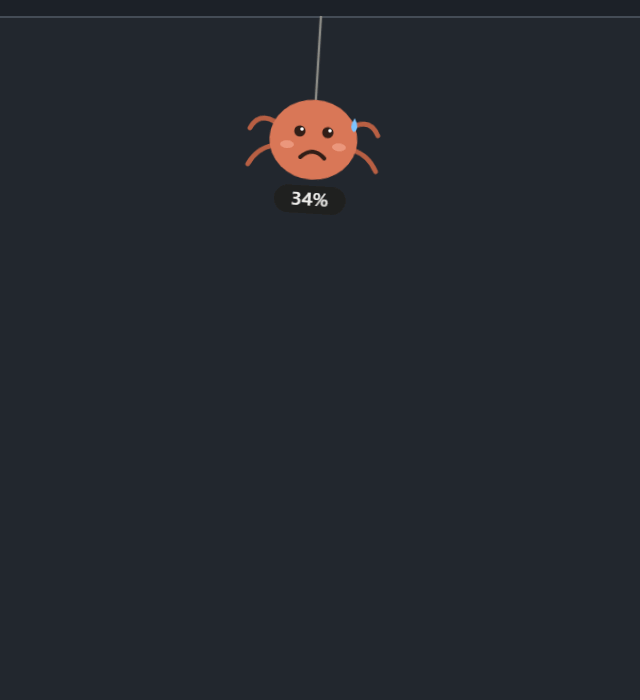
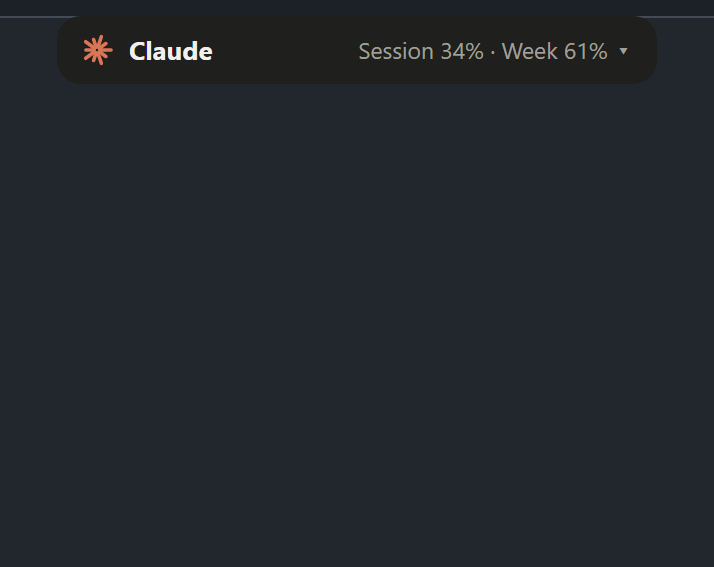
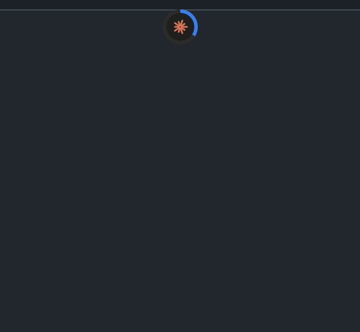
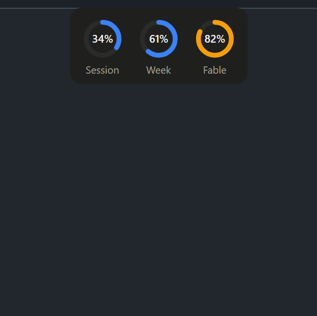
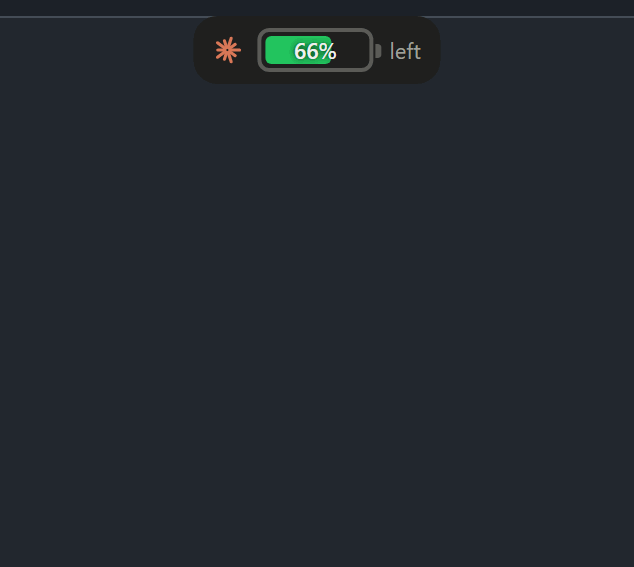
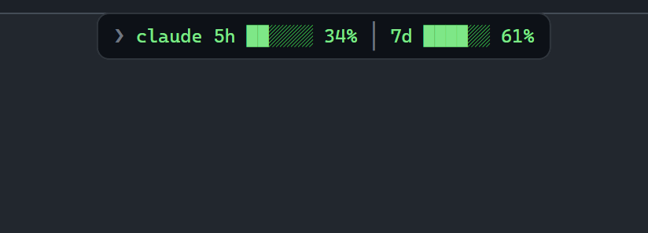

<div align="center">



# Claude Usage Pebble

**Your Claude plan usage, always one glance away.**

A tiny always-on-top desktop widget that shows your current session, this week, and any per-model weekly limits.<br>
Six layouts, from a 30px dot to a little critter hanging off the top of your screen.

<p>
  <a href="#install-and-run"></a>
  <a href="#install-and-run"></a>
  <a href="#install-and-run"></a>
  <a href="https://www.electronjs.org"></a>
  <a href="https://nodejs.org"></a>
  <a href="LICENSE"></a>
</p>
<p>
  <a href="https://github.com/mu-ki/claude-usage-pebble/releases"></a>
  <a href="https://github.com/mu-ki/claude-usage-pebble/stargazers"></a>
  <a href="https://github.com/mu-ki/claude-usage-pebble/commits/main"></a>
  
  <a href="#contributing"></a>
</p>

<h3>
  <a href="#install-and-run">Quick start</a> ·
  <a href="#layouts">Layouts</a> ·
  <a href="#how-it-works">How it works</a> ·
  <a href="#build-an-app-file">Build</a> ·
  <a href="#adding-a-layout">Add a layout</a>
</h3>

```bash
git clone https://github.com/mu-ki/claude-usage-pebble.git && cd claude-usage-pebble && npm install && npm start
```

<sub>Unofficial community project. Not affiliated with or endorsed by Anthropic. "Claude" is a trademark of Anthropic.</sub>

</div>

---

## Why you'll like it

| | |
|---|---|
| 🪶 **Tiny and out of the way** | Sits on top of every window, takes a few pixels, drag it anywhere. |
| 📊 **Every limit at once** | Current session, this week, and per-model weekly limits (for example Fable). |
| 🎨 **Six layouts** | Bar, dot, critter, rings, battery or terminal. Switch with a right-click. |
| 🚦 **Warns you early** | Bars turn amber at 75% and red at 90%. The critter gets worried above 80%. |
| 🔒 **Private by design** | Talks only to claude.ai. No server, no analytics, no telemetry. |
| 💻 **Cross-platform** | Windows, macOS and Linux, from one small Electron app. |

## Layouts

Right-click the widget → **Layout** to switch. Your choice and position are remembered.

<div align="center">

<table>
  <tr><th>Layout</th><th>Click it and the details drop down</th></tr>
  <tr>
    <td><b>Classic bar</b><br>A slim tab at the top of the screen showing session and week at a glance.</td>
    <td></td>
  </tr>
  <tr>
    <td><b>Tiny dot</b><br>A 30px ring that fills with session usage. The smallest option.</td>
    <td></td>
  </tr>
  <tr>
    <td><b>Hanging critter</b><br>Swings on a thread, hangs lower as the week fills up, smiles when you're fine and looks worried above 80%.</td>
    <td></td>
  </tr>
  <tr>
    <td><b>Rings</b><br>One gauge per limit, always visible.</td>
    <td></td>
  </tr>
  <tr>
    <td><b>Battery</b><br>How much of the session is <i>left</i>, like a phone battery.</td>
    <td></td>
  </tr>
  <tr>
    <td><b>Terminal</b><br>A monospace status line for the command-line crowd.</td>
    <td></td>
  </tr>
</table>

</div>

Bars turn amber at 75% and red at 90%. Demos use sample data.

To preview every layout live, serve the folder (for example `npx serve .`) and open `docs/gallery.html`, or open `widget.html?layout=critter&open` directly. After changing a layout, run `npm run screenshots` to regenerate the demo GIFs and the still images in `docs/screenshots`.

## Install and run

You need [Node.js](https://nodejs.org) 18 or later.

```bash
git clone https://github.com/mu-ki/claude-usage-pebble.git
cd claude-usage-pebble
npm install
npm start
```

On first run the widget says **Click to sign in**. Click it, sign in to claude.ai in the window that opens, and it closes by itself. If Google sign-in is refused inside the app, use the email sign-in option.

### Controls

- **Click** the widget to expand or collapse it
- **Drag** to move it anywhere on screen
- **Right-click** for Refresh now, Layout, Sign in / switch account, Start at login, and Quit

## Build an app file

```bash
npm run dist
```

This builds for the OS you run it on:

| OS | Output in `dist/` |
|---|---|
| Windows | Portable `.exe` |
| macOS | `.dmg` (runs as a menu-bar-style app with no Dock icon) |
| Linux | `.AppImage` |

macOS builds must be made on a Mac. Unsigned builds show a security warning the first time you open them.

## How it works

- You sign in to claude.ai once in a small window. The session is stored by Electron in the app's own data folder.
- Every 5 minutes, a hidden window opens `claude.ai/settings/usage` for a few seconds, reads the numbers, and closes again. It asks claude.ai for the usage data first; if that fails, it reads the numbers off the page text.
- Nothing is sent anywhere except claude.ai. There is no server, analytics or telemetry.

The data comes from claude.ai's web app, not a public API, so a claude.ai update can break it. If the widget shows an error, please open an issue.

## Project layout

```
main.js          window, layout menu, settings, fetching usage, sign-in, start at login
preload.js       narrow bridge between the page and the main process
widget.html      all six layouts (plain HTML/CSS/JS, no build step)
docs/gallery.html  preview of every layout with sample data
docs/capture.js    generates docs/screenshots and the demo GIF (npm run screenshots)
```

### Adding a layout

1. Add a function to the `layouts` object in `widget.html`. It returns HTML for the current `state` and `open` flag. Mark the clickable part with `data-toggle`, and reuse `list()` for the expanded details.
2. Add `['your-id', 'Your name']` to `LAYOUTS` in `main.js`.

The window resizes itself to fit whatever your layout renders.

## Contributing

Issues and pull requests are welcome. New layouts are especially fun to add, see [Adding a layout](#adding-a-layout). If claude.ai changes and the widget starts showing an error, please [open an issue](https://github.com/mu-ki/claude-usage-pebble/issues).

## Credits

Inspired by [claude-usage-tool](https://github.com/IgniteStudiosLtd/claude-usage-tool), a macOS menu bar app.

## License

[MIT](LICENSE)

<div align="center">
<sub>If the pebble saves you from a surprise limit, a ⭐ helps other people find it.</sub>
</div>
